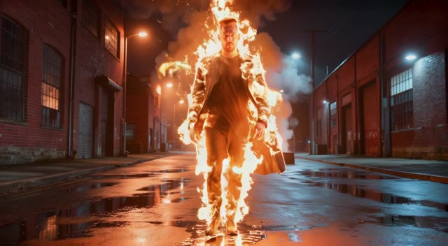
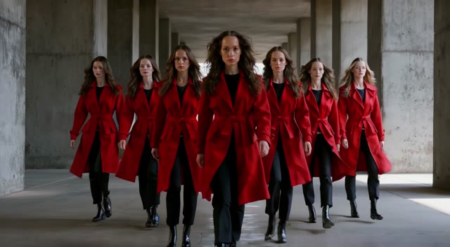
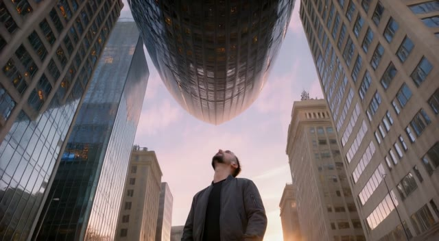
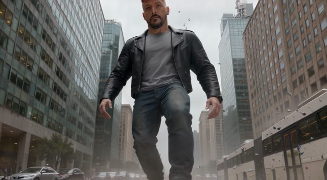
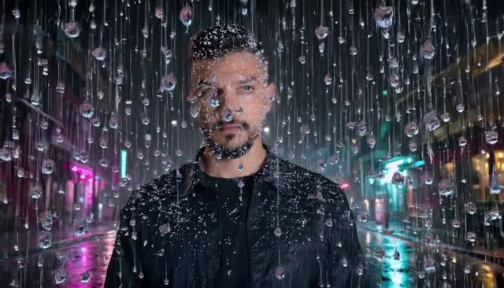

# VFX 4 All

**Cinematic VFX presets for everyone.** Drop a photo or a video clip, pick an effect, and get a
film-grade VFX shot with sound: a walk through fire, a body turning to liquid chrome, a clone army,
a city folding overhead.

VFX 4 All is an open source app built on the **Comfy Developer Platform**. It runs open-weights
models (LTX-2.5 and Qwen Image Edit 2511) through the official Comfy SDK, either on Comfy Cloud or on
your own ComfyUI.

| Walk of Fire | Liquid Chrome | Synchronized | The Fold |
|---|---|---|---|
|  |  |  |  |
| **Disintegrate** | **Colossus** | **Zero Gravity** | **Frozen Rain** (beta) |
|  |  |  |  |

## Two ways in

**From a photo.** Upload one or two photos of a person. Each preset builds its own film scene
around them (location, wardrobe, lens, light), keeps their face, and then animates the effect.
You can also skip the scene and animate your own image as it is.

**From a video.** Upload a clip you filmed or generated, scrub to the moment the effect should
start, and VFX 4 All continues the shot from that exact frame. The result is your clip up to the
cut, then the effect, joined on the same frame so the cut is invisible. Clips from 2 to 60 seconds,
480p to 4K, up to 500 MB (`VIDEO_LIMITS` in `vfx4all/config.py`).

**In Comfy Cloud, no key at all.** Every preset that animates a single first frame (41 of the 45)
can also run as a Comfy Cloud App Mode app: one graph that takes your photo, builds the scene and
renders the effect. You open it with your own
Comfy account and run it with your own credits; nobody hands an API key to anyone.
`tools/build_app_graph.py` builds those graphs from the presets.

## How it works

```
photo(s) --> Qwen Image Edit 2511 --> first frame of the preset's scene --+
                                                                         +--> LTX-2.5 DFR image to video --> shot with audio
your image (as it is) ---------------------------------------------------+
                                                                         |
video clip --> frame at the chosen second -------------------------------+--> splice back into the clip

first frame --> Qwen Image Edit 2511 (or a mirror) --> last frame --> LTX-2.5 first and last frame --> shot with audio
```

* `workflows/` holds the ComfyUI graphs in API format: the scene, the LTX-2.5 DFR effect (default)
  and the classic two pass effect (`VFX4ALL_EFFECT_PIPELINE=classic`). See [workflows/README.md](workflows/README.md)
  for every node the app sets.
* `presets/` holds one JSON file per effect: a scene prompt, an effect prompt written for that scene,
  and a generic prompt for user images and video splices. Copy one to make your own. A preset can
  also ask for a last frame (`last_frame_prompt`, edited from the first frame with Qwen Image Edit
  2511, or `last_frame_mode: "mirror"`) to be animated first-to-last, a LoRA from the Comfy Cloud
  catalog (`effect_lora`), or to be played backward after rendering (`post: "reverse"`).
* `vfx4all/` is a small FastAPI server. It submits the graphs with `comfy-sdk`, follows the jobs
  (and cancels them), checks every take (a black or NaN take is retried with the next seed),
  repeats the uploads and downloads that time out, and splices videos with ffmpeg.
* `web/` is the interface: plain HTML, CSS and JavaScript, no build step. It shows the prompt that
  was sent, keeps your results across reloads and compares a spliced clip with your original.
* `tools/build_app_graph.py` builds the App Mode graphs and `tools/batch_presets.py` renders test
  versions of the presets; `tools/dev/` keeps the A/B scripts behind the choices in
  [workflows/README.md](workflows/README.md).

## Run it

Python 3.10 or newer.

```bash
git clone <this repo> vfx4all
cd vfx4all
python -m venv .venv
.venv/Scripts/pip install -r requirements.txt   # on macOS or Linux: .venv/bin/pip
cp .env.example .env                            # then paste your COMFY_API_KEY
.venv/Scripts/python run.py                     # opens http://127.0.0.1:8420
```

ffmpeg ships inside the `imageio-ffmpeg` wheel, so there is nothing else to install.
`requirements.txt` pins the exact versions the app is tested with.

No photo or clip at hand? `samples/` has two photos and two clips to try both modes; see
[samples/README.md](samples/README.md) for which effect to pair with each.

### Run the tests

```bash
.venv/Scripts/python -m unittest -v
```

The tests run offline in a few seconds. They check every preset and graph, the App Mode builder,
the upload limits, the ffmpeg steps (phone clips shot vertical included), the HTTP API with its
hosted mode, access code and daily cap, the job queue, and that every model the graphs load is
listed in `THIRD_PARTY_NOTICES.md`. They never reach Comfy Cloud (the test package blanks
`COMFY_API_KEY` before the app loads), so they cost nothing. GitHub Actions runs them on Linux and
Windows with Python 3.10 and 3.12. Only a real render tells you whether a prompt works.

## Who pays for the generations

Every generation bills the Comfy Cloud workspace that owns the API key it runs with.

* **Running it yourself:** you put your own key in `.env`, so you pay for your own runs. API access
  needs a paid Comfy Cloud plan. Keys come from [platform.comfy.org](https://platform.comfy.org).
* **Sharing it without keys:** link each preset to its Comfy Cloud App Mode app (the `comfy_app`
  field of the preset). Visitors sign in to Comfy and their runs bill their own account.
* **Hosting it for others:** visitors can paste their own key in **Advanced**. The key stays in their
  browser and travels in the `X-Comfy-Key` header, so their runs bill their workspace; the server
  uses it for that job only and never stores it. If they leave it empty, the server key from `.env`
  is used, so read [Hosting it](#hosting-it) before you expose the app.
* **Your own GPU, no cloud credits:** the models are open weights, so the same app can drive your own
  ComfyUI through [comfy-api-proxy](https://github.com/Comfy-Org/comfy-api-proxy). Set
  `COMFY_BASE_URL=http://127.0.0.1:8189` in `.env`.

Only open-weights models run in the workflows, so no partner API credits are used: Comfy Cloud
charges GPU time. In our tests on Comfy Cloud a scene took about 10 seconds of GPU and a 6 second
Draft effect between 12 and 30 seconds.

## Presets

45 presets in 8 categories:

| Category | Presets |
|---|---|
| Elements | Walk of Fire, Disintegrate, Ice Age, Lightning Strike, Smoke Exit, Water Body, Sandstorm, Ember Wings |
| Transformations | Liquid Chrome, Gold Touch, Stone Statue, Glass Shatter, Paper Fold, Inflate, Hologram, Wings of Light |
| Clones | Synchronized, Mirror Hall, Crowd of Me, Shadow Twin |
| Worlds | The Fold, Earth Zoom, Portal Jump, Mini World, Mirror City, Lidar Scan, Paint World |
| Scale | Colossus, Ant Size, Pocket Giant |
| Physics | Zero Gravity, Gravity Flip, Bullet Dodge, Super Jump, Shockwave |
| Time | Frozen Rain, Bullet Time, Rewind, Aging, Stop Motion |
| Style | Comic Panel, Anime Shift, Claymation, Neon Outline, Film Noir |

Walk of Fire, Liquid Chrome, Synchronized, The Fold, Disintegrate, Colossus and Zero Gravity are
stable; the other 38 are marked beta in the app (see [Limits](#limits)). Most presets take all three
inputs. These run only from a photo, because the effect depends on its own scene or on a last frame
built from it: Colossus, Frozen Rain, Mirror Hall, Shadow Twin, Ant Size, Pocket Giant, Bullet Time
and Comic Panel. Rewind takes a photo or your own image, not a video.

### Make your own preset

Add a JSON file to `presets/`:

```json
{
  "id": "my-effect",
  "name": "My Effect",
  "category": "Elements",
  "description": "One line for the card.",
  "modes": ["scene", "own_image", "video"],
  "duration": 6,
  "wardrobe": {"man": "...", "woman": "...", "person": "..."},
  "scene_prompt": "Create a new cinematic film still in {aspect_words} format. {references} The {subject} is the only person in the new still, with exactly {their} face, eyes, nose, jaw, hairline, hairstyle, hair colour{facial_hair}, skin tone and build{identity_notes}. The clothing, the place and the light come only from this description. ...",
  "effect_prompt": "Use the provided start image as the first frame. ...",
  "generic_prompt": "Use the provided start image as the first frame. ..."
}
```

Placeholders: `{subject}` (man, woman or person), `{their}`, `{Their}`, `{them}`, `{wardrobe}`,
`{aspect_words}`, `{identity_notes}`, `{references}` and `{facial_hair}`. `{references}` introduces
the photos the way Qwen Image Edit 2511 reads them ("Image 1 and image 2 are two photos of the same
man. Use them only as the identity reference.", or the one-photo version), and `{facial_hair}` adds
", facial hair" for a man only, so a woman's scene is never asked to keep a beard. Prompts avoid
subject pronouns so the verbs agree for all three subjects. A thumbnail at `web/thumbs/<id>.jpg` and
a short loop at `web/previews/<id>.mp4` make the card.

Prompting notes that made these presets work: describe the state the shot starts in rather than
the transition into it, give every effect a sound, lock counts and scale with a named rule (for
example "CLONE COUNT LOCK: seven figures in the final frame"), and keep every instruction positive.
For scenes, name each photo with its role and keep the identity block above as it is: with the old
wording ("the person from the reference images") Qwen Image Edit 2511 exaggerated grey hair and
earrings. In wide full-body shots the face gets small and likeness drops, so frame the subject
closer when the effect allows it.

## Quality

Draft renders at 896x512 (16:9) and HQ at 1280x704, both at 24 fps. The effect runs through LTX-2.5
DFR (Diffusion Fidelity Rendering): detailing keyframes plus a spatial x2 pass with the
Refine-Details IC-LoRA. Against the classic graph it keeps faces and textures much sharper; the
A/B is in [workflows/README.md](workflows/README.md). For delivery, upscale the
shots you keep, for example with the RTX Video nodes in ComfyUI.

## Limits

What VFX 4 All does not do well yet, from our own test runs:

* **Likeness drifts in the strongest transformations.** The scene keeps the face from your photo,
  but effects that turn the whole body into another material or style (Stone Statue, Mirror Hall,
  Anime Shift) lose part of the likeness by the last frame. Start from a sharp photo where the face
  is clearly visible.
* **One person per run.** Presets are written for a single subject (man, woman or person). Group
  photos, pets and objects are not supported; the clone presets make the copies themselves.
* **Short shots.** An effect lasts 4 to 6 seconds (the preset's `duration`) at 24 fps. Draft is
  896x512 and HQ 1280x704, or the vertical equivalents. Upscale the shots you keep in another tool.
* **Video mode continues one frame.** The effect is rendered from the frame at the cut, so it does
  not inherit the camera move or the motion of your clip, and its sound is generated. 36 of the
  45 presets take a video. Clips must be 2 to 60 seconds, 480p to 4K and up to 500 MB.
* **Black takes.** Comfy Cloud sometimes returns an all black take or stops with a NaN error, and in
  our tests these came in waves. The app checks every take and retries with a new seed (for most
  presets two DFR attempts, then the classic graph); when every attempt fails, the job fails. Every attempt uses GPU time, so a run that
  needed retries costs more.
* **Beta presets.** 38 of the 45 presets are marked beta: they work but vary more between takes,
  and some show artifacts (a stray pillar in Earth Zoom, rough paper in Paper Fold). Try two or
  three seeds.
* **Last frame presets take an extra step.** Ant Size and Comic Panel first edit a last frame with
  Qwen Image Edit 2511 (Bullet Time mirrors the first one) and then animate first to last, so they
  only run from a photo scene and spend one more image generation. Rewind renders forward and plays
  the result backward, sound included.
* **App Mode covers 41 presets.** Ant Size, Bullet Time, Comic Panel and Rewind need more than one
  graph or a step after rendering, so they only run in the VFX 4 All server.
* **Comfy Cloud model names.** The graphs load models by their Comfy Cloud catalog names. On your
  own ComfyUI you need the same files under the same names, and a rename in the catalog breaks a
  graph until it is updated.
* **Commercial use depends on the models.** Photo scenes and last frames come from Qwen Image Edit
  2511 (Apache 2.0). LTX-2.5 is free only for entities under USD 10,000,000 in annual revenue. The
  Hologram preset uses a style LoRA with no published license. Details in
  [THIRD_PARTY_NOTICES.md](THIRD_PARTY_NOTICES.md).
* **No cost display.** The app does not estimate what a run costs. Check the usage of your Comfy
  Cloud workspace.
* **One server, one process.** Jobs live in memory and in their `job.json`, so run a single
  instance. Finished jobs survive a restart; a job the restart interrupted is marked failed with the
  ids of its Comfy Cloud jobs, whose results may still be in your Comfy history.

## Hosting it

By default VFX 4 All is a local app: it listens on 127.0.0.1, has no login and keeps every run in
`runs/`. To open it to other people, set `VFX4ALL_MODE=hosted` (see `.env.example`):

* Jobs, uploads and results belong to the browser session that made them; nobody else can list or
  open them, and `job.json` and error logs are never served.
* Clips are capped at 30 s and 100 MB, a session runs two jobs at a time
  (`VFX4ALL_SESSION_JOBS`) and one network six (`VFX4ALL_IP_JOBS`), and runs and uploads older
  than 48 hours are deleted (`VFX4ALL_RETENTION_HOURS`).
* `VFX4ALL_ACCESS_CODE` asks for a code before any upload or generation, for example a demo for a
  jury. Visitors enter it in **Advanced**.
* `VFX4ALL_DAILY_RUNS` caps the generations the server accepts per UTC day, so a shared link can
  never spend more than you planned. Set it whenever the server key pays.

The `Dockerfile` builds that setup (hosted mode, port 8420, runs on a `/data/runs` volume). Put it
behind a reverse proxy with HTTPS and set `FORWARDED_ALLOW_IPS` to the proxy's address. The server
sends a strict Content Security Policy and serves the fonts itself, so the page loads nothing from
other sites. If you host it for others, the LTX license asks you to put its Section 4 and the
Acceptable Use Policy into your own terms (see [THIRD_PARTY_NOTICES.md](THIRD_PARTY_NOTICES.md)).

## Consent

Only use photos and videos of people who agreed to it. The app asks you to confirm that before
every upload, and sends what you upload to the Comfy workspace of the key in use.

## License

MIT for the code in this repository. The models, ffmpeg, the NoMa Studio AI brand assets and the
demo media keep their own licenses or owners: see [THIRD_PARTY_NOTICES.md](THIRD_PARTY_NOTICES.md),
and read the model licenses before you use the results commercially.

Made by NoMa Studio AI for the #OpenSourceHiggsfield challenge.
